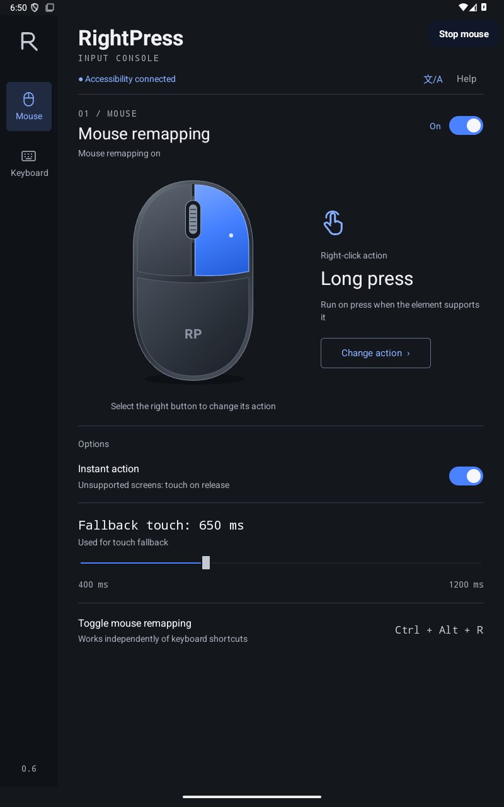
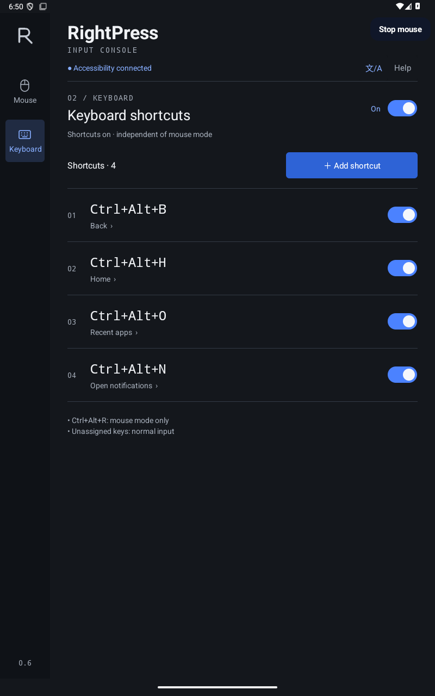

# RightPress

**Android 14 이상** 마우스 버튼·외장 키보드 단축키 유틸리티.

- 베타 버전: **0.6.0-beta.1**
- 다운로드: [GitHub 베타 출시 페이지](https://github.com/doctor-clawler/rightpress/releases/tag/v0.6.0-beta.1)의 APK
- Google Play: 미등록
- 앱 표시 언어: **30개 언어·31개 로캘**. 중국어 간체·번체 포함.

[English](README.md) · [개인정보 안내](PRIVACY.md) · [변경 기록](CHANGELOG.md) · [언어 지원](LOCALIZATION.md) · [기여 안내](CONTRIBUTING.md)

<p>
  
  
</p>

화면: Android 에뮬레이터에서 실행한 0.6.0-beta.1 세로 화면. 접근성 사용 전 고지·동의 필요.

## 기능

- 우클릭: 길게 누르기 · 뒤로 · 홈 · 최근 앱 · 알림 열기.
- 키보드: 뒤로 · 홈 · 최근 앱 · 알림 열기 · 빠른 설정 · 앱 실행 · 마우스 변환 켜기/끄기.
- 마우스·키보드 별도 스위치. 단축키별 사용 여부 설정.
- 계정·광고·분석 도구·인터넷 권한 없음. 설정은 기기 안에 저장.
- 세로·가로·좁은 화면 대응. RTL 언어 지원.
- 시스템 기본 폰트 사용. 별도 폰트·번역 SDK 없음.
- 앱 사용에 루트·ADB·Shizuku 불필요.

길게 누르기: **버튼을 누르는 순간** 포인터 아래 요소에 접근성 롱클릭 요청. 미지원·거절 시 버튼을 뗀 뒤 터치 롱프레스. `즉시 실행`을 끄면 항상 버튼을 뗀 뒤 실행. 호환 터치 시간은 기본 650ms, 범위 400~1200ms. 나머지 우클릭 동작은 누를 때 실행.

## 베타 설치

1. [Releases](https://github.com/doctor-clawler/rightpress/releases/tag/v0.6.0-beta.1)에서 APK 다운로드. Actions 산출물은 개발용 debug 빌드.
2. Android 14 이상 기기에 설치. 필요 시 다운로드 앱의 외부 앱 설치 허용.
3. RightPress 실행 → `접근성 서비스 켜기` → 사용 안내 확인 → 동의.
4. 앱에서 Android 접근성 설정 열기 → **RightPress 입력 도우미** 켜기.
5. 앱 복귀 → `마우스`·`키보드` 탭 설정.

외부 설치 앱의 접근성이 제한된 경우: 신뢰하는 APK에 한해 Android **앱 정보 → 더보기 → 제한된 설정 허용**. 메뉴 이름은 기기별 차이 있음.

**공식 0.5.0 베타 사용자:** 새 서명 APK로 업데이트 설치. 패키지·배포 서명키 유지. 설정·단축키 유지.

**이전 비공개 테스트판 사용자:** 베타 패키지는 `io.github.doctor_clawler.rightpress`, 서명은 전용 배포키 사용. 기존 `com.example.rightpress` debug 앱(0.4.0 이하)과 별개이므로 **업데이트가 아닌 새 설치**. 기존 설정을 기록하고 기존 접근성 서비스를 먼저 OFF. 두 앱을 함께 둘 수 있지만 RightPress 서비스는 하나만 활성화. 설정 자동 이전 없음. 베타에서 다시 설정 필요. 직접 빌드한 debug APK도 공식 베타와 서명이 달라 덮어쓰기 불가.

## 언어

[언어 선택 화면](docs/images/languages.png)

- 상단 **文/A** → 언어의 원어 이름 선택. **시스템 기본값**으로 기기 언어 따르기.
- Android 앱별 언어 설정에서도 같은 항목 변경 가능. 지원 언어가 없으면 영어 표시.
- 언어 변경 후에도 단축키 조합·동작·기능 설정 유지.
- 주요 모바일·인터넷 시장을 고려한 30개 언어. RightPress 실제 사용량 순위 아님.
- 초기 베타 번역. 원어민 감수 미실시. 오류 제보 시 언어·화면·수정 문구 포함.
- 폰트는 Android 기본 폰트·대체 글리프 사용. 추가 폰트 파일·다운로드 없음. 번역 텍스트만큼 APK 용량 증가 가능.

언어 목록·추가 절차: [LOCALIZATION.md](LOCALIZATION.md).

## 단축키·중지

| 기본 단축키 | 동작 |
| --- | --- |
| `Ctrl+Alt+B` | 뒤로 |
| `Ctrl+Alt+H` | 홈 |
| `Ctrl+Alt+O` | 최근 앱 |
| `Ctrl+Alt+N` | 알림 열기 |
| `Ctrl+Alt+R` | 마우스 변환 켜기/끄기. 변경 불가 |

추가: `키보드 → ＋ 단축키 추가 → 키 조합 입력` → Ctrl 또는 Alt + 일반 키 입력 → 동작 선택 → 저장. Shift 추가 가능. Esc로 입력 대기 취소. 꺼진 규칙을 포함해 중복 조합 등록 불가. Meta/Windows·Sym·Fn 조합 미지원.

- 마우스 중지: `Ctrl+Alt+R` · 우측 상단 `마우스 끄기` · 마우스 스위치.
- 등록 단축키 중지: `키보드 단축키` OFF. 고정 `Ctrl+Alt+R`은 계속 사용 가능.
- 전체 중지·접근성 권한 해제: Android 접근성 설정에서 서비스 OFF.
- 앱 화면 종료 후에도 서비스 유지. 기능별 ON/OFF 저장.
- 서비스 시작·재연결은 Android가 관리. 중단 없는 상시 실행 보장 없음.

## 제약·검증 범위

마우스 변환은 전체 화면 투명 접근성 레이어로 입력을 받아 터치로 중계. 좌클릭·드래그는 탭·스와이프, 휠은 터치 스크롤로 처리. 호버·정밀 드래그·텍스트 선택·멀티터치는 원래 입력과 차이 가능. 불편하면 마우스 변환 OFF. 키보드 단축키는 별도 사용 가능.

- 즉시 실행: 대상 앱 지원 필요. 성공 응답 후 화면 반응이 없으면 `즉시 실행` OFF 후 버튼을 떼는 방식 사용.
- 시스템·보안 화면, 게임, 기기 정책, 예약 단축키에 따른 제한 가능.
- 앱 실행: RightPress에서 조회 가능한 실행 앱만 지원.
- 미지원: 키-대-키 변경 · 문구 자동 입력 · 매크로 · 앱별 프로필.
- 실물 태블릿·Bluetooth/USB 입력장치·DeX·분할 화면·외부 디스플레이·배터리 영향: 추가 검증 필요.
- 특정 외부 앱의 동작 보장 없음. 에뮬레이터 검증·GitHub 베타 배포와 Google Play 심사는 별개.

오류 제보: [GitHub Issues](https://github.com/doctor-clawler/rightpress/issues). 앱·Android 버전, 기기·입력장치 모델, 연결 방식, 화면 방향, 재현 단계 포함. 공개 게시물이므로 개인정보·인증정보·비공개 화면 제외. 보안 취약점은 [SECURITY.md](SECURITY.md) 참조.

## 접근성·개인정보

- 입력 이벤트: 등록 단축키 비교에 사용. 키 입력 이력·입력 문장 저장 없음.
- 화면 요소: 위치·계층·지원 동작 확인. 요소 텍스트를 읽거나 저장하지 않음.
- 화면 내용·스크린샷 저장 없음.
- 로컬 저장: 등록 조합·동작·선택 앱 식별자·기능 설정·동의 상태. 앱 언어 선택은 Android가 기기에 저장.
- 인터넷 권한·분석 SDK 없음. [개인정보 안내](PRIVACY.md) 참조.

## 빌드·검사

- JDK 17 · Android SDK Platform 35 · Build Tools 35.0.0 · 번역 검사에 Python 3 사용.
- `ANDROID_HOME` 설정 또는 Git에서 제외된 `local.properties`에 `sdk.dir` 지정.

```sh
python3 tools/localization.py check
./gradlew :app:assembleDebug :app:lintDebug :app:assembleDebugAndroidTest
```

- Gradle 8.10.2 wrapper 포함. 배포 파일 SHA-256 검증.
- APK: `app/build/outputs/apk/debug/app-debug.apk`.
- debug 빌드: 로컬 debug 서명. 공식 베타에 업데이트 설치 불가.
- 배포 서명키: 저장소·GitHub Actions에 미포함.

자체 release 빌드: 개인 서명키 정보 4개를 로컬 비밀정보 관리 방식으로 환경 변수에 설정한 뒤 `./gradlew :app:assembleRelease` 실행.

- `RIGHTPRESS_SIGNING_STORE_FILE`
- `RIGHTPRESS_SIGNING_STORE_PASSWORD`
- `RIGHTPRESS_SIGNING_KEY_ALIAS`
- `RIGHTPRESS_SIGNING_KEY_PASSWORD`

서명 정보 누락 시 `assembleRelease` 실패. 출력: `app/build/outputs/apk/release/app-release.apk`. 개인 서명키는 공식 베타와 다름. 키 비공개 보관·업데이트용 유지 필요.

- GitHub Actions: push·PR·수동 실행 시 번역 누락·서식 인자 검사, debug 빌드·lint·계측 테스트 컴파일. `RightPress-debug-build` 산출물 제공. 기기 테스트 실행은 CI 범위 밖.
- 기기 테스트: `app/src/androidTest`. 일부 검사는 테스트용 root 접근이 가능한 일회용 AOSP 에뮬레이터에서 `evdev` 입력 사용. 실물 기기에 일반 테스트 명령으로 실행하지 않음. 테스트 도구는 설치용 APK에서 제외. 앱 자체는 루트 불필요. [기여 안내](CONTRIBUTING.md) 참조.

## 라이선스

- RightPress 고유 코드·시각 자산: [MIT](LICENSE).
- Gradle wrapper: 원저작자 라이선스 유지. [제3자 고지](THIRD_PARTY_NOTICES.md).
- Key Mapper 공개 문서의 입력→동작 설정 흐름 참고. 구현·시각 자산은 별도 제작. Key Mapper 코드·자산 미포함.
